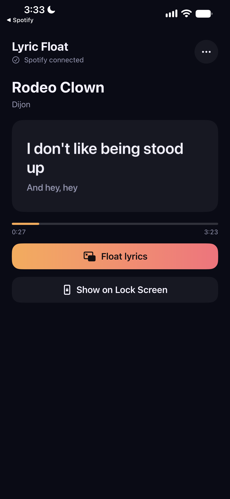
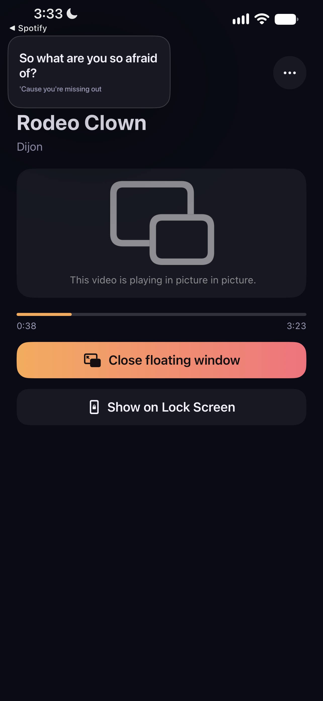
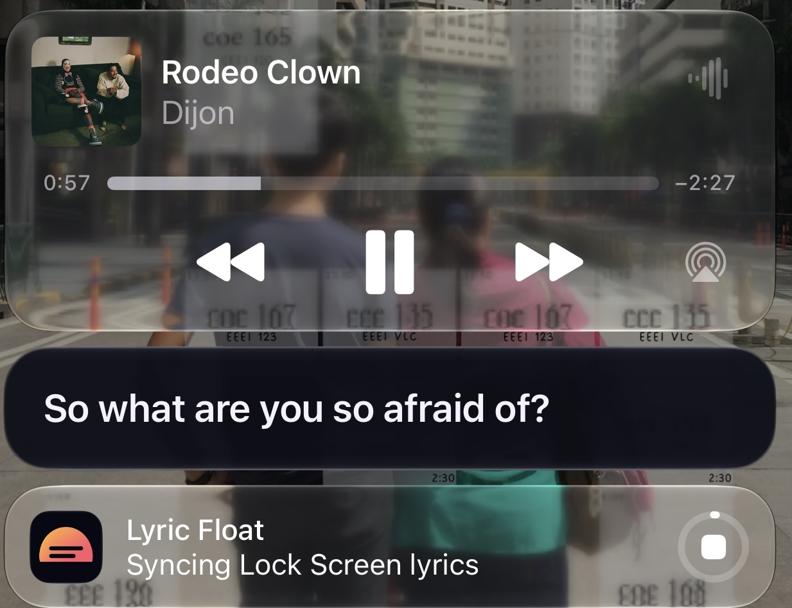
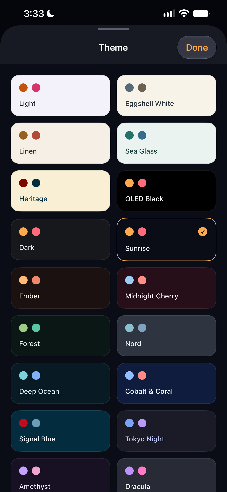
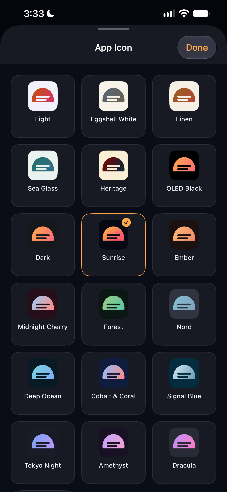
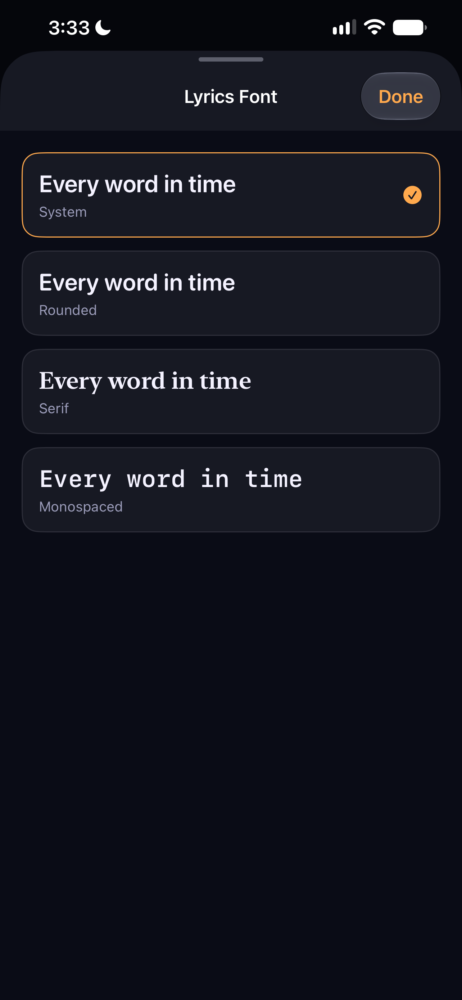
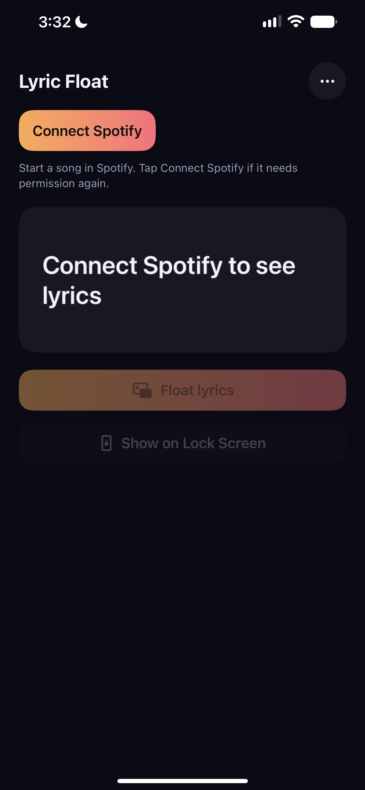
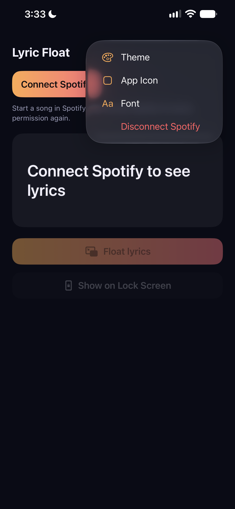
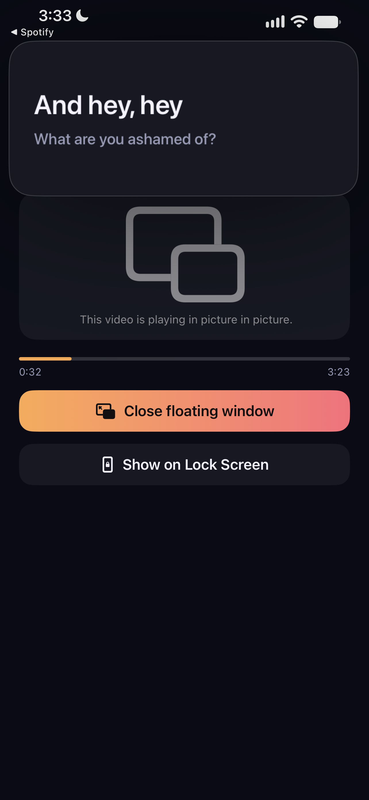
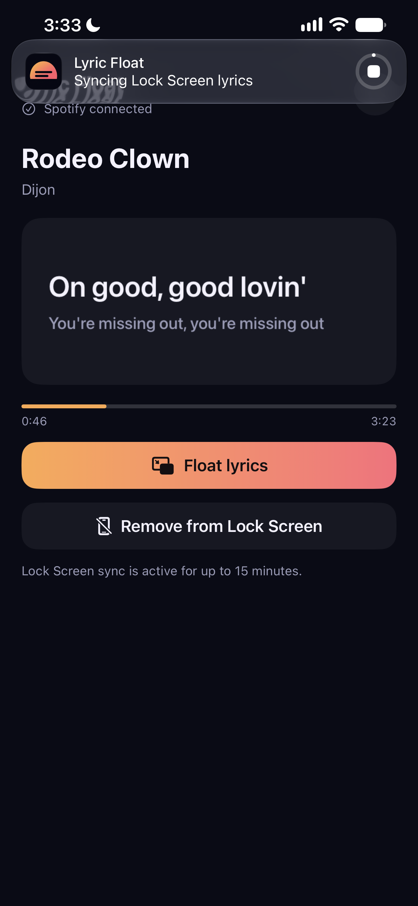

# Lyric Float

Follow synced Spotify lyrics in a floating Picture in Picture window or on your iPhone’s Lock Screen. Lyric Float reads playback from the Spotify app on the same iPhone. The app requires iOS 17 or later. Continuous Lock Screen sync requires iOS 26.

[Privacy policy](PRIVACY.md)

  
  

## Install and connect

1. Download `LyricFloat.ipa` from the [GitHub Releases](https://github.com/TristanSibug/lyric-float/releases). Sideload it with AltStore and choose **Keep App Extensions**.
2. Play a song in Spotify, then open **Lyric Float** and tap **Connect Spotify**. Approve the connection in Spotify.
3. When lyrics appear, tap **Float lyrics** or **Show on Lock Screen**.

If you installed the previous App Remote build, update it with the same AltStore account. The app now appears as **Lyric Float** and can reuse its saved Spotify connection and appearance settings. If you also installed the older Spotify Web API build, you can remove that separate app from your iPhone.

## Appearance and playback

Open the **Options** menu to pick a theme, lyric font, or Home Screen icon. The font and theme apply to floating lyrics and the Lock Screen card. Use **Timing adjustment** if a track’s lyrics are early or late.

On iOS 26, **Show on Lock Screen** starts a session that can follow multiple songs for up to 15 minutes. iOS may show a separate progress card while sync runs. When the session ends, the lyrics card closes, the app shows the reason, and **Show on Lock Screen** is available again. On earlier iOS versions, Lock Screen lyrics can go stale when iOS suspends the app. Tap the card to reopen Lyric Float and refresh. [Apple Live Activities](https://developer.apple.com/documentation/activitykit/displaying-live-data-with-live-activities)

## Screenshots

  

Themes, icons, and lyric fonts

  
  
  

Setup and playback controls

  
  

  
  

## Build from source

Open `LyricFloat.xcodeproj` in Xcode 26 or later. The project pins Spotify’s iOS SDK at 5.0.1 via Swift Package Manager.

In your Spotify Dashboard app settings, enable **iOS** and register the bundle ID `app.lyricfloat.remote` and redirect URI `app.lyricfloat.remote.oauth://callback`. Set `SPOTIFY_CLIENT_ID` to your Spotify app’s public Client ID in Xcode and choose an iPhone target. [Spotify iOS setup](https://developer.spotify.com/documentation/ios/getting-started)

Lyric lookup sends the track’s title, artist, album, and duration to LRCLIB. Verify that the use case is permitted before distributing a Spotify-connected build. [Spotify Developer Policy](https://developer.spotify.com/policy)
